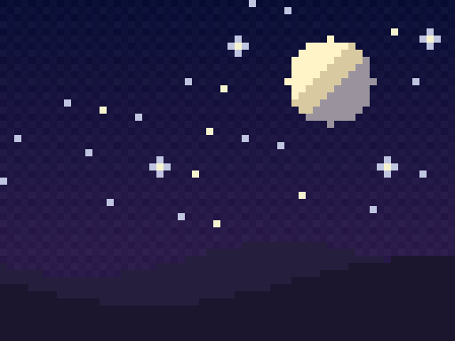
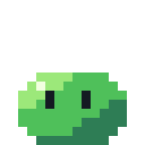

# Kiro Pixel Art (Aseprite)

Create, animate, and export **pixel art with Aseprite** directly from
[Kiro CLI](https://kiro.dev), using natural language and slash commands.

<p align="center">
  
  <br>
  <em>The Kiro ghost, recreated in pixel art with this tool (rendered through real Aseprite).</em>
</p>

This is a **port of [willibrandon/pixel-plugin](https://github.com/willibrandon/pixel-plugin)**
(a Claude Code plugin) to Kiro's agent + skills model. It wires the bundled
[`pixel-mcp`](https://github.com/willibrandon/pixel-plugin) MCP server into a
Kiro agent and ships six workflow skills plus five slash-command skills.

> Requires [Aseprite](https://www.aseprite.org/) v1.3.0+ installed locally.

## Examples

<p align="center">
  
  <br>
  <em>Starry night — hue-shifted sky with ordered dithering, scatter stars, a
  terminator-shaded moon, and low-contrast hills for depth (see
  <code>examples/starry-night.lua</code>).</em>
</p>

<p align="center">
  
  <br>
  <em>A slime hop cycle in four directions (down / up / left / right), kept
  consistent in palette, size and timing — one character seen from several sides
  (see <code>examples/slime-walk.lua</code>).</em>
</p>

See the [`examples/`](examples) folder for the scripts that generated each piece.

## What you get

**Agent** (`pixel-art`) — registers the `pixel-mcp` server as the `@aseprite`
MCP server (50+ Aseprite tools: canvas, layers, drawing, frames, tags, palette
quantization, dithering, shading, spritesheet export, …).

**Workflow skills** (auto-triggered by natural language):

| Skill | Use for |
| --- | --- |
| `pixel-art-creator` | canvas, layers, basic shapes |
| `pixel-art-animator` | frames, tags, timing, walk/idle/attack cycles |
| `pixel-art-professional` | dithering, palette optimization, shading, antialiasing |
| `pixel-art-exporter` | PNG/GIF/spritesheet/JSON for Unity, Godot, Phaser |
| `pixel-art-grid` | generate pixel art as structured **grid-JSON** (24×24 ints + palette) and render it to a real sprite — based on the [Pixel Art Bench Lite](https://huggingface.co/datasets/AINovice2005/pixel-art-bench-lite) benchmark |
| `pixel-art-rules` | **MUST / SHOULD / AVOID rulebook** (78 rules + validation checklist): silhouette, palette ramps, clusters & noise, banding, shading, anti-aliasing, dithering, animation, and the tells of AI-generated pixel art |

**Command skills** (slash commands):

| Command | Description |
| --- | --- |
| `/pixel-new [size] [palette]` | Create a sprite with presets |
| `/pixel-palette <action> [args]` | Set / optimize / show / export palettes |
| `/pixel-export <format> [file]` | Export PNG / GIF / spritesheet / JSON |
| `/pixel-setup [path]` | Configure pixel-mcp + Aseprite |
| `/pixel-help [topic]` | Help |

## Install

```bash
git clone https://github.com/JoseValencia125/kiro-pixel-art.git
cd kiro-pixel-art
./install/install.sh            # auto-detects Aseprite
# or point at a specific binary:
./install/install.sh "/Applications/Aseprite.app/Contents/MacOS/aseprite"
```

The installer:

1. Detects your OS/arch and downloads the matching `pixel-mcp` binary from the
   upstream repo into `~/.local/share/pixel-mcp/bin/`.
2. Detects (or accepts) your Aseprite path and writes
   `~/.config/pixel-mcp/config.json`.
3. Installs the skills into `~/.kiro/skills/` and the agent into
   `~/.kiro/agents/pixel-art.json` (with your paths filled in).
4. Runs a health check.

Supported platforms: macOS (arm64/x86_64) and Linux (arm64/x86_64).

## Usage

```
/agent pixel-art
/pixel-new 64x64 nes
"Create a 32x32 Game Boy character with a 4-frame walk cycle"
/pixel-export sheet spritesheet.png layout=grid
```

## Uninstall

```bash
./install/uninstall.sh
```

## How the port differs from the Claude plugin

- The Claude plugin used `${CLAUDE_PLUGIN_ROOT}` and a Claude marketplace. Here
  the MCP server is registered through a **Kiro agent** (`mcpServers.aseprite`)
  with absolute paths filled in at install time.
- Claude "commands" became **Kiro skills** (slash commands), and skill
  frontmatter was converted to Kiro's format (`name` + `description`,
  `$ARGUMENTS`).
- Tool references were updated to the names actually exposed by `pixel-mcp`
  v0.5.0 (e.g. `export_sprite` / `export_spritesheet` / `quantize_palette`).

## Structured grid-JSON (Pixel Art Bench Lite)

The `pixel-art-grid` skill adds a structured-output workflow based on the
[`AINovice2005/pixel-art-bench-lite`](https://huggingface.co/datasets/AINovice2005/pixel-art-bench-lite)
benchmark (Apache-2.0). You describe a subject; the agent emits a 24×24 grid of
integers `0-9` plus a color palette, and renders it to a real sprite with
Aseprite.

```json
{ "grid": [[0,1,1, ...], ...], "palette": ["transparent", "yellow", "orange"] }
```

Render and score any grid-JSON:

```bash
# render (paths via env vars; this Aseprite build ignores --script-param)
GRID_JSON=sun.json GRID_OUT=sun.png GRID_SCALE=16 \
  "$ASEPRITE" -b --script skills/pixel-art-grid/scripts/render-grid.lua

# score it (JSON validity + quality = 0.7*diversity + 0.3*density)
python3 skills/pixel-art-grid/scripts/score-grid.py sun.json
```

The seven benchmark prompts (mario, rainbow, sun, saturn, maze, mona_lisa, hope)
ship in `skills/pixel-art-grid/scripts/bench-prompts.json` as ready-made tests.
See [`examples/kiro-ghost-grid.json`](examples/kiro-ghost-grid.json) for the Kiro
ghost expressed in this format.

## Pixel-art rulebook

The `pixel-art-rules` skill is a compact, actionable rulebook the agent reads
before drawing or reviewing. It has **78 rules** grouped as **MUST / SHOULD /
AVOID** across 12 topics (fundamentals, palette & colour, silhouette, outlines,
lines & curves, clusters & noise, shading & light, anti-aliasing, dithering,
readability, animation, and generated-art tells), plus an 11-point validation
checklist to run before calling a sprite done.

It is synthesised and paraphrased from established pixel-art teaching — Pixeli's
rulebook, *Pixel Logic*, Saint11, Daniel Silber, SLYNYRD, Lospec, Derek Yu,
Pixel Joint and Helm (credited in [`NOTICE`](NOTICE)). The `pixel-art-grid`
scorer covers the mechanical half; this checklist covers the rest.

## Credits & License

- Upstream plugin and the `pixel-mcp` server: **Brandon Williams**
  ([willibrandon/pixel-plugin](https://github.com/willibrandon/pixel-plugin)),
  MIT License — see [`LICENSE.upstream`](LICENSE.upstream) and [`NOTICE`](NOTICE).
- This Kiro port: MIT License — see [`LICENSE`](LICENSE).

The `pixel-mcp` binary is **not** redistributed in this repo; the installer
downloads it from the upstream repository at install time.
